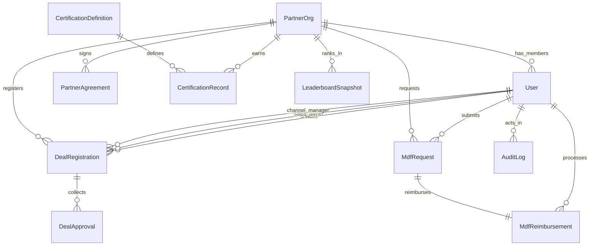

# Domain Model

## Entity ownership map

- `User`
  Schema/model file: `prisma/schema.prisma` (`model User`)
  Primary service owner: `src/lib/auth/session.ts` via `getRequestSession()` for request identity and `src/lib/auth/permissions.ts` for role capability mapping.
- `PartnerOrg`
  Schema/model file: `prisma/schema.prisma` (`model PartnerOrg`)
  Primary service owner: `src/services/partnerService.ts` via `listPartners()` and `createPartner()`.
- `PartnerAgreement`
  Schema/model file: `prisma/schema.prisma` (`model PartnerAgreement`)
  Primary service owner: `src/services/partnerService.ts` because onboarding creates the first agreement in the same transaction as the partner.
- `CertificationDefinition`
  Schema/model file: `prisma/schema.prisma` (`model CertificationDefinition`)
  Primary service owner: `src/services/certificationService.ts` indirectly consumes definitions when recording partner certifications.
- `CertificationRecord`
  Schema/model file: `prisma/schema.prisma` (`model CertificationRecord`)
  Primary service owner: `src/services/certificationService.ts` via `recordCertification()`.
- `DealRegistration`
  Schema/model file: `prisma/schema.prisma` (`model DealRegistration`)
  Primary service owner: `src/services/dealRegistrationService.ts` via `createDeal()`, `listDeals()`, and `transitionDeal()`.
- `DealApproval`
  Schema/model file: `prisma/schema.prisma` (`model DealApproval`)
  Primary service owner: `src/services/dealRegistrationService.ts`, which appends approval history during `transitionDeal()`.
- `MdfRequest`
  Schema/model file: `prisma/schema.prisma` (`model MdfRequest`)
  Primary service owner: `src/services/mdfService.ts` via `createRequest()`, `decideRequest()`, and `reimburseRequest()`.
- `MdfReimbursement`
  Schema/model file: `prisma/schema.prisma` (`model MdfReimbursement`)
  Primary service owner: `src/services/mdfService.ts` via `reimburseRequest()`.
- `LeaderboardSnapshot`
  Schema/model file: `prisma/schema.prisma` (`model LeaderboardSnapshot`)
  Primary service owner: `src/services/reportingService.ts` via `refreshLeaderboardSnapshot()`.
- `AuditLog`
  Schema/model file: `prisma/schema.prisma` (`model AuditLog`)
  Primary service owner: `src/lib/audit/auditLogger.ts` via `recordAuditEvent()`.
- `BackgroundJob`
  Schema/model file: `prisma/schema.prisma` (`model BackgroundJob`)
  Primary service owner: `src/services/backgroundJobService.ts` via `processDueJobs()`.

## Relationship notes

- `PartnerOrg` is the core ownership anchor for partner-visible data. Deal and MDF records both carry `partnerOrgId`, which is why `src/lib/auth/visibility.ts` can enforce one scoping rule across multiple repositories.
- `DealApproval` is deliberately separate from `DealRegistration` status fields so reviewers can reconstruct the approval path even after the current status changes.
- `MdfReimbursement` is a one-to-one child of `MdfRequest` so finance cannot accidentally create multiple payouts for the same request.
- `LeaderboardSnapshot` is a derived table, not a source-of-truth table. Live computation still exists in `src/services/reportingService.ts`, and the snapshot exists to support async refresh.

## Deal workflow as implemented

`src/domain/dealRegistration.ts:12-20` is the only source of legal transitions:

| From | To | Permission |
|---|---|---|
| DRAFT | SUBMITTED | `deal:submit` |
| SUBMITTED | SALES_APPROVED, REJECTED | `deal:approve_sales` |
| SALES_APPROVED | APPROVED, REJECTED | `deal:approve_channel` |
| APPROVED | CLOSED_WON, CLOSED_LOST | `deal:close` |
| REJECTED, CLOSED_WON, CLOSED_LOST | — | terminal |

`dealRepository.updateStatus` (`src/repositories/dealRepository.ts:130-146`) stamps `submittedAt`, `approvedAt`, or `closedAt` for the corresponding targets, and writes `rejectionReason` only for `REJECTED`. It clears it (sets `null`) on every other transition. Each transition also appends a `DealApproval` row carrying `fromStatus`, `toStatus`, `actorUserId`, and `note` (`dealRegistrationService.ts:109-119`). That table, not `rejectionReason`, is the durable history.

Only the `→ APPROVED` edge queues a `LEADERBOARD_REFRESH` background job (lines 135-150). The job is processed later by `backgroundJobService.processDueJobs` (`src/services/backgroundJobService.ts:12-43`), which marks it `RUNNING`, then `SUCCEEDED` or `FAILED`.

## Exercise

**Goal:** List the timestamps set on a deal that goes DRAFT → SUBMITTED → SALES_APPROVED → APPROVED → CLOSED_WON.
**Check:** `submittedAt` (first edge), nothing for SALES_APPROVED, `approvedAt` (third edge), and `closedAt` (fourth). Each assignment uses `undefined` for the other fields, so earlier timestamps are preserved (lines 137-142).
